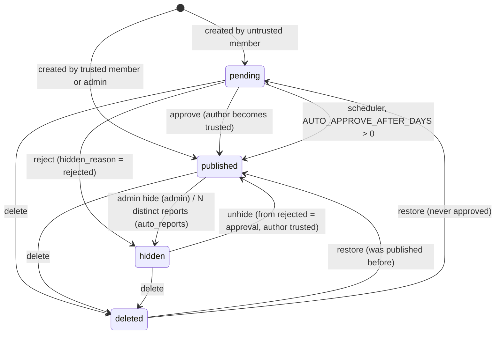
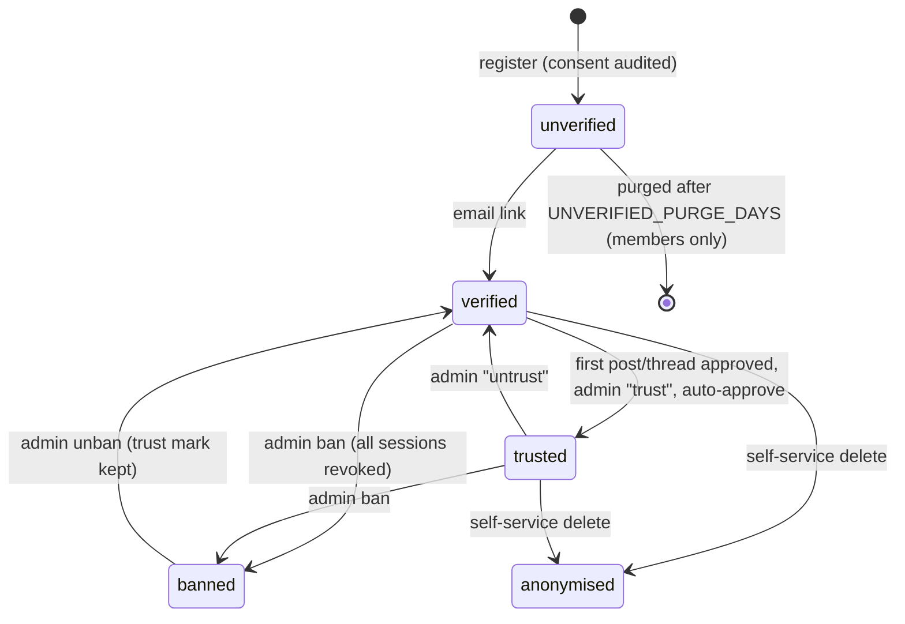

# Architecture

This document describes how the URBANFLOODS Cooperation Platform (deliverable D.5.1.1) is put
together: the system context, the backend layers, the data model and its state machines, the
path a post takes from the editor to the database, the background jobs, and the security
controls. It is written for developers and operators who maintain the platform after the
project. Scope and decisions live in [PLAN.md](PLAN.md); the HTTP interface is in [api.md](api.md).

Last updated: 2026-10-31

## 1. System context

```
Browser ──HTTPS──> Cloudflare (proxy, DNS, Turnstile)
                     │
                     ▼
             host nginx  cooperation.urbanfloods.app  (TLS via certbot)
                     │
                     ▼
     127.0.0.1:3002  frontend container (nginx + built Vue SPA)
        /                → SPA (index.html, assets)
        /api/            → backend:8000
        /static/uploads/ → backend:8000
        /feeds/, /sitemap.xml, /robots.txt → backend:8000
                     │
                     ▼
     127.0.0.1:8002  backend container (FastAPI, one worker)
        ├─ asyncpg ─────> PostgreSQL 16 (internal network only, no host port)
        ├─ httpx GET ───> KNOWBASE public API  https://knowbase.urbanfloods.app/api/v1
        ├─ aiosmtplib ──> smtp.gmail.com:587 (STARTTLS)
        └─ httpx POST ──> challenges.cloudflare.com (Turnstile siteverify)
```

- The production files (`docker-compose.prod.yml`, frontend `nginx.prod.conf`, host nginx
  template) are increment M6 and do not exist yet. The routing above is the design in
  [PLAN.md](PLAN.md#architecture) plus the 5b note that `/feeds`, `/sitemap.xml` and
  `/robots.txt` must reach the backend. [CHECK after 6a/6b]
- Production is same-origin (`VITE_API_BASE_URL=""`), so the session cookie is first-party. CORS
  (`ALLOWED_ORIGINS`) matters only for the Vite dev server on `http://localhost:5173`.
- The **KNOWBASE** (a separate delivered application) is never modified. The backend sends only
  `GET` requests to an allow-list of its public routes (`backend/app/services/knowbase.py`). The
  browser never calls the KNOWBASE API; measure photos are plain `` links to
  `KNOWBASE_PUBLIC_URL/static/...`. The frontend has no KNOWBASE library pages: browsing happens
  on knowbase.urbanfloods.app (user decision 2026-10-31; the header and home card link out). It
  keeps the editor's link picker, the link cards and the item pages `/knowbase/measures/:id` and
  `/knowbase/documents/:id` ("Mentioned in" list).
- The Unified DSS is a link-out only (`VITE_DSS_URL`, default `https://urbanfloods.finki.ukim.mk/`).

Development stack (`docker-compose.yml`): `postgres` (host port 5432), `mailpit` (UI/API 8025,
SMTP 1025), `backend` (`fastapi dev`, port 8000, source bind-mounted), `frontend` (Vite, port
5173). See [testing.md](testing.md) and the root [README](../README.md).

## 2. Backend layering

```
backend/app/
  main.py                    app factory: middleware, routers, lifespan (KNOWBASE client, scheduler)
  api/v1/endpoints/<r>.py    thin routes: parse → call crud → return schema; raise AppError
  api/v1/schemas/<r>.py      Pydantic models (Base / Summary / Detail / Paginated {total, items})
  crud/<r>.py                async functions, keyword-only args; never commit (DbTx does)
  db/models.py, enums.py     explicit declarative models; junctions as Table objects
  services/                  side effects: email, knowbase, sanitize, images, digest, scheduler,
                             notifications, turnstile, slugs, csv_cells
  core/                      config, security, deps, csrf, rate_limit, logging, exceptions
  cli.py                     operator commands (see admin-handbook.md)
  templates/email/<locale>/  Jinja2 email templates (en complete, el partial; en fallback)
```

- One transaction per request: the `DbTx` dependency (`core/deps.py`) commits when the endpoint
  returns and rolls back when it raises. It commits before the response is sent, so a client
  never sees success for a write that failed to commit.
- Settings are read only in `core/config.py` (pydantic-settings, env vars or `.env`).
- Errors are `AppError(status, code, message)` → `{"detail": {"code", "message", "fields"?}}`.
- Migrations: Alembic, `backend/alembic/versions/0001`–`0006` (extensions; auth tables with the
  seeded 22 organisations; expertise; blog; forum; moderation). The container entrypoint runs
  `alembic upgrade head` before starting the server.

Middleware order on a request: `RequestId → CORS → RateLimit → CSRF → route`.

## 3. Data model

Postgres 16 with the `pg_trgm` and `citext` extensions. Integer primary keys (BIGINT for replies
and comments), `created_at`/`updated_at` timestamps, soft delete via `status` + `deleted_at`.

| Table | Purpose |
|---|---|
| `organisations` | 22 seeded project partners (PP/AP) plus admin-added ones; `is_partner`, country, website |
| `users` | email (citext), argon2id hash, display name, organisation or free-text organisation, country, locale, bio, avatar, role, `is_verified`, `is_active` (false = banned), `trusted_at`, `deleted_at`, `show_email`, `show_in_directory` |
| `expertise_tags`, `user_expertise` | seeded expertise vocabulary and the member junction (matchmaking) |
| `sessions` | opaque session tokens (SHA-256 hash stored), expiry, last seen, user agent, revoked |
| `email_tokens` | verify (48 h), reset (1 h), change-email (24 h) tokens, hashed, single use |
| `notification_preferences` | per-user email switches and `admin_digest` / `digest_frequency` |
| `audit_log` | actor, action, target, JSON metadata for every status, role and account change |
| `categories` | blog and forum categories (9 seeded; "Resources" is `admin_only`); archived, never deleted |
| `tags`, `post_tags`, `thread_tags` | free tags with `usage_count` (published content only) |
| `attachments` | uploaded images (WebP + thumbnail), alt text required |
| `posts` | blog posts: title, slug, excerpt, sanitised `body_html` + `body_text`, cover, locale, optional `event_at`/`event_url`, status, `hidden_reason`, `report_count`, generated `fts` column |
| `threads` | forum threads: as posts without excerpt/cover, plus `is_pinned`, `is_locked`, `reply_count`, `last_activity_at` |
| `replies` | thread replies; one level of nesting enforced by a trigger |
| `comments` | comments on posts |
| `knowbase_links` | KNOWBASE document/measure linked from a post or thread, with cached titles (max 10 per item) |
| `reports` | one report per reporter per item: reason, details, status `open/resolved/dismissed` |
| `digest_runs` | one row per admin digest run (window, recipients, items) |

Triggers (migration 0005) keep `threads.reply_count`, `threads.last_activity_at` and
`posts.comment_count` in step and reject a reply to a reply's reply.

### 3.1 Content state machine

Posts and threads (replies and comments have no `pending` state). Implemented in
`backend/app/crud/moderation.py` (`TRANSITIONS`); any other edge answers 409
`moderation.invalid_transition`. Every transition writes a `moderation.<action>` audit row.



Unhide and restore-to-published dismiss the item's open reports and reset `report_count`.

### 3.2 User state machine



Roles are orthogonal: `member`, `admin`, `superadmin`. Admins and superadmins publish without
review whether or not they carry a trust mark. An anonymised account keeps its row (content stays,
shown as "Deleted user"); see [admin-handbook.md](admin-handbook.md#13-gdpr-requests).

## 4. Request flow: creating a post

`POST /api/v1/posts/` with a JSON body.

1. `RequestIdMiddleware` assigns `X-Request-ID`.
2. `RateLimitMiddleware`: `api.default` 300/min per client IP.
3. `CSRFMiddleware`: `Origin`/`Referer` must be an allowed origin; with the session cookie present,
   `X-Requested-With: XMLHttpRequest` is required.
4. Route dependencies: `posts.create` limit (20/h per IP), `require_verified` (signed in, email
   verified, account active).
5. `crud/post.py:create_post`:
   - category must be a non-archived blog category; `admin_only` categories need an admin (403
     `posts.category_admin_only`);
   - `body_html` passes through `services/sanitize.py:sanitize_html` (nh3 allow-list, `h1` → `h2`,
     links get `rel="nofollow noopener noreferrer"`, images only from http(s) or
     `/static/uploads/`); `body_text` and the excerpt are derived from the clean HTML;
   - **status**: `published` (with `published_at`) if the author has `trusted_at` or is an admin,
     else `pending`;
   - tags are found or created; KNOWBASE links (max 10) are validated and their titles cached
     through the proxy (503 if the KNOWBASE is unreachable and nothing is cached).
6. Endpoint writes a `post.created` audit row; `DbTx` commits; the response is the post detail.

A pending post is visible only to its author and to admins until it is approved.

## 5. Visibility rule

One rule, `backend/app/crud/visibility.py`, used by every list, detail, mention and search query:

| Caller | Sees |
|---|---|
| anonymous, member | `published` |
| author | additionally their own content in any status except `deleted` |
| admin / superadmin (verified) | everything except `deleted` (deleted too where an admin view asks for it) |

Exports, feeds and the sitemap use published content only.

## 6. KNOWBASE proxy and caching

`services/knowbase.py`, one `KnowbaseClient` on `app.state.knowbase`.

| Cache class | TTL | Max entries |
|---|---|---|
| lists and search | `KNOWBASE_CACHE_TTL_LIST` (900 s) | 512 |
| details | `KNOWBASE_CACHE_TTL_DETAIL` (21600 s) | 2048 |
| lookups | 86400 s (constant) | 64 |

- Every successful response is also copied into a per-class "stale" store (no TTL). When the
  upstream fails (timeout `KNOWBASE_TIMEOUT_SECONDS`=5, connection error, 5xx, bad JSON) the
  stale copy is served with `X-Knowbase-Cache: stale`; with nothing cached the API answers 503
  `knowbase.unavailable`.
- A per-key `asyncio.Lock` makes concurrent misses share one upstream request; failures are
  remembered for 60 s.
- `GET /api/v1/knowbase/status` reports reachability and cache sizes without calling upstream;
  admins can empty the caches (`POST /api/v1/admin/knowbase/cache/clear`).
- Lookups are allow-listed (documents: `countries`, `levels`, `subjects`, `keywords`; measures:
  `categories`, `levels-of-application`, `scales`, `keywords`).

## 7. Email

`services/email.py`: Jinja2 templates in `templates/email/<locale>/<name>.{subject.txt,txt.j2,html.j2}`
(English fallback if any file is missing). Backends: SMTP (aiosmtplib, `SMTP_*` settings) when
`EMAIL_ENABLED=true`; a logging backend when it is false; an in-memory outbox in tests. Dev
compose sends to Mailpit.

| Template | Sent when |
|---|---|
| `verify_email` | registration, resend, admin resend |
| `welcome` | after verification |
| `reset_password` | forgot password |
| `change_email` | email change requested (to the new address) |
| `reply_to_thread`, `reply_to_reply`, `comment_on_post` | notifications, honouring the recipient's preferences; sent as background tasks after commit |
| `admin_digest` | scheduler or `python -m app.cli digest` |

Account emails that fail are logged (`auth.email_not_sent`, `email.send_failed`) and do not fail
the request; the user can ask again. Addresses are not written to logs by the SMTP path.

## 8. Scheduler jobs

APScheduler 3 `AsyncIOScheduler` (UTC) started in the lifespan only when `ENABLE_SCHEDULER=true`
(`services/scheduler.py`). Both jobs coalesce, run one instance at a time and have a 1-hour
misfire grace.

| Job | Schedule | What it does | Settings |
|---|---|---|---|
| `maintenance` | daily at `DIGEST_HOUR_UTC − 1`:00 UTC (05:00 by default) | deletes sessions and email tokens expired/used/revoked more than 7 days ago; hard-deletes unverified **members** registered more than `UNVERIFIED_PURGE_DAYS` (30) days ago; hard-deletes attachments older than `ORPHAN_UPLOAD_HOURS` (24) that are no cover, no avatar and not referenced in any body (files removed after commit); auto-approves pending posts/threads older than `AUTO_APPROVE_AFTER_DAYS` (0 = off) | `UNVERIFIED_PURGE_DAYS`, `ORPHAN_UPLOAD_HOURS`, `AUTO_APPROVE_AFTER_DAYS` |
| `admin_digest` | daily at `DIGEST_HOUR_UTC`:00 UTC (06:00 by default) | emails pending items, open reports, new members and new content to admins (see [moderation-guide.md](moderation-guide.md#5-the-admin-digest)) | `DIGEST_HOUR_UTC` |

Each maintenance step runs in its own transaction; a failed step is logged and reported as `-1`.
The same code runs from the CLI (`python -m app.cli maintenance|digest`).

## 9. Rate limits

In-memory GCRA limiter (`core/rate_limit.py`), keyed by limit name and client IP
(`CF-Connecting-IP` when `TRUST_PROXY_HEADERS=true`, else the socket peer). A burst of `times`
is allowed, then one request every `seconds / times`. Exceeding a limit answers 429
`rate.limited` with `Retry-After`. `RATE_LIMIT_ENABLED=false` turns everything off.

| Limit | Applies to | Budget |
|---|---|---|
| `api.default` | every request under `/api/` | 300 / minute |
| `auth.register` | `POST /auth/register` | 5 / hour |
| `auth.login` | `POST /auth/login` | 10 / 15 minutes |
| `auth.resend_verification` | `POST /auth/resend-verification` | 3 / hour |
| `auth.password_forgot` | `POST /auth/password/forgot` | 3 / hour |
| `auth.password_reset` | `POST /auth/password/reset` | 10 / hour |
| `auth.email_confirm` | `POST /auth/email/confirm` | 10 / hour |
| `auth.me_password` | `POST /auth/me/password` | 10 / hour |
| `auth.me_email` | `POST /auth/me/email` | 5 / hour |
| `posts.create` | `POST /posts/` | 20 / hour |
| `threads.create` | `POST /threads/` | 20 / hour |
| `replies.create` | `POST /threads/{id}/replies/` | 60 / hour |
| `comments.create` | `POST /posts/{id}/comments/` | 30 / hour |
| `reports.create` | `POST /reports/` | 20 / day |
| `uploads.images` | `POST /uploads/images/` | 30 / day |
| `search` | `GET /search/` | 60 / minute |

Paths outside `/api/` (`/feeds/*`, `/sitemap.xml`, `/robots.txt`, `/static/uploads/*`, `/health`)
have no application rate limit.

## 10. Security controls

- Sessions: opaque 32-byte tokens, only the SHA-256 hash stored; cookie `uf_session` HttpOnly,
  SameSite=Lax, Secure when `COOKIE_SECURE=true`; 30-day sliding expiry (`SESSION_TTL_DAYS`);
  revocable per session; password reset, ban and account deletion revoke all sessions.
- Passwords: argon2id (library defaults), 10–128 characters, common-password list.
- CSRF: SameSite=Lax + origin check on every unsafe request + `X-Requested-With` header when
  the cookie is present (`core/csrf.py`).
- Bot defence: Cloudflare Turnstile on register, resend-verification and forgot-password
  (`TURNSTILE_ENABLED`); email verification before posting; first-post review; report auto-hide.
- Uniform answers: forgot-password and resend always return 202.
- Tokens: random, hashed at rest, single use, with expiry. Confirming an email change cancels
  outstanding verify/reset tokens; a password reset or change cancels pending email changes.
- HTML: nh3 allow-list on the server (`services/sanitize.py`), DOMPurify in the browser
  (`components/common/SafeHtml.vue`).
- Uploads: JPEG/PNG/WebP only (sniffed by Pillow), ≤ `MAX_UPLOAD_MB` (5 MiB), ≤ 40 megapixels,
  re-encoded to WebP (metadata incl. EXIF/GPS dropped), random names, served with `nosniff`.
- Authorisation: role dependencies in `core/deps.py`; last-superadmin and self-change guards in
  the admin endpoints; every mutating endpoint has owner/admin/superadmin tests.
- Audit log for moderation, role, trust, ban, consent, login, export and account deletion.
- No IP addresses in the database; rate-limit logs use a keyed hash of the IP.
- Logs: structlog to stdout (JSON when `LOG_JSON=true`); no passwords, tokens or bodies.
- Postgres is not published on the host in production; secrets only in the production env
  file (M6). Security headers (HSTS, CSP, X-Frame-Options) belong to the host nginx (M6). [CHECK after 6b]

## 11. Single-worker constraints

The backend must run as **one worker process** (the image runs `fastapi run` with its default of
one worker). Three components keep state in process memory:

1. the rate-limit buckets (several workers would multiply every budget);
2. the KNOWBASE caches (each worker would cache and call upstream separately);
3. the scheduler (each worker with `ENABLE_SCHEDULER=true` would send its own digest).

Restarting the backend empties the caches and the rate-limit buckets. Scaling out would need a
shared store (for example Redis) for limits and cache, and the scheduler moved to one process.
